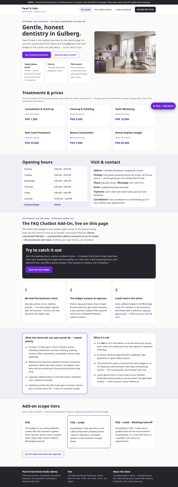
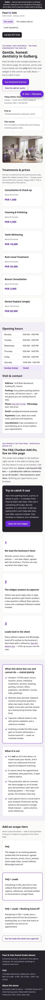

# AI Chatbot Add-On Demo Page

**Portfolio Build Queue #12 — Multi-Talented Services (MTS)**
Owner of the queue: AICOS-116 (Portfolio Curator) · Repo & hosting: AICOS-114 (GitHub, Hosting & Deployment)

- **Industry / type:** Add-on showcase — FAQ-level chatbot on a sample business page
- **Design system:** MTS Core (house systems owned by AICOS-112)
- **Key integrations (demo data):** Chat widget (FAQ scope only), lead capture to Google Sheet
- **Built by:** AICOS-113 (Website Integrations), on an AICOS-105 page
- **Pricing v3 mapping:** AI chatbot add-on (Pricing v3)

**Status: BUILT — 2026-11-21 · Visual Quality Scorecard 91/100 (evidence bar; see repo files for the verdict)**

Rules for this repo: one repo per portfolio asset · hosted preview link (Netlify default) once built · this asset is a **DEMO** and is labelled DEMO wherever it is shown · integrations pre-wired with demo data only · QA pass by AICOS-115 before it is shown to any prospect.

---

## Preview — Full-Page Screenshots

**Desktop — full page:**

**Phone — full page:**

